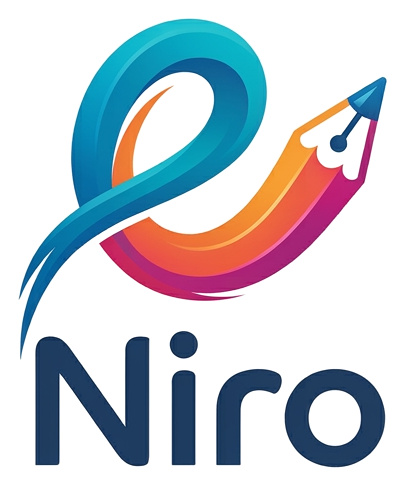

<p align="center">
  
</p>

<h1 align="center">niro</h1>

<p align="center">
  <strong>An open, Miro-style infinite whiteboard: draw, plan and present together in real time.</strong>
</p>

<p align="center">
  
  
  
  
  
  
  <a href="LICENSE"></a>
</p>

<p align="center">
  <a href="#features">Features</a> ·
  <a href="#quick-start">Quick start</a> ·
  <a href="#collaboration-and-accounts">Collaboration</a> ·
  <a href="#keyboard-shortcuts">Shortcuts</a> ·
  <a href="#how-it-works">How it works</a> ·
  <a href="#roadmap">Roadmap</a>
</p>

---

## Table of contents

- [About](#about)
- [Features](#features)
- [Quick start](#quick-start)
- [Collaboration and accounts](#collaboration-and-accounts)
- [Using niro on your phone or another computer](#using-niro-on-your-phone-or-another-computer)
- [Configuration](#configuration)
- [Keyboard shortcuts](#keyboard-shortcuts)
- [How it works](#how-it-works)
- [Project structure](#project-structure)
- [Scripts](#scripts)
- [Where your data lives](#where-your-data-lives)
- [Roadmap](#roadmap)
- [Contributing](#contributing)
- [License](#license)
- [Acknowledgements](#acknowledgements)

## About

niro is an infinite canvas for sticky notes, shapes, images, connectors, freehand drawing, frames and slide decks,
built with React, TypeScript and Yjs. It works fully in the browser on its own (boards are saved locally,
no account needed), and a small optional server adds what makes a whiteboard a team tool:

- **Real-time collaboration**: everyone on a board edits at once, sees each other's cursors, selections and
  typing, and can follow someone's view or bring everyone along while presenting.
- **Accounts and sharing**: sign in, keep boards with your account on every device, share them with people
  as editors or viewers, or open them to anyone with the link, including guests without an account.
- **Offline first**: changes are saved in the browser right away and merge with everyone else's when the
  connection comes back. Edits never overwrite each other.

## Features

### Canvas and items

- **Infinite canvas**: wheel to pan, Ctrl/Cmd + wheel or pinch to zoom (5%–800%), right-drag (like Miro),
  Space + drag, middle mouse or the Hand tool to pan; a dotted grid that adapts to the zoom.
- **Items**: sticky notes, text, rectangles and ellipses (click to place, or drag to size).
- **Shapes** (like Miro): the Rectangle tool (R) opens a shapes flyout: rectangle, rounded rectangle, triangle,
  diamond, parallelogram, hexagon, star, arrow, cylinder and speech bubble, all with text inside. Change a
  shape later from its toolbar. Connectors meet a shape's real outline (a diamond's corners, a triangle's sides).
- **Borders** on rectangles, shapes and ellipses: color, width (or none) and pattern (solid, dashed, dotted).
- **Emoji** (J or the toolbar): pick from reactions, status signs, things and arrows; placed in the middle of
  the view, resized like any item (keeps its shape).
- **Link cards** (K, or paste a web address): a card with the page's title (looked up by the niro server,
  public addresses only) and its site; ↗ opens it. Edit the title or address from its toolbar.
- **Comments** (C): click the board to start a thread; a pin marks it. Click a pin to read and reply
  (Ctrl+Enter), resolve / reopen or delete; drag a pin to move it. Pins keep their size at any zoom and move
  with their frame. Viewers can read comments.
- **Lock** (toolbar or Ctrl+Shift+L): locked items can be selected, copied and connected to, but not moved,
  resized, edited or deleted. A locked frame stays put while what is inside stays editable.
- **Images**: paste a picture (Ctrl+V), drop image files on the board, or use the Image button (I). PNG, JPEG,
  GIF and WebP up to 10 MB; resizing keeps the picture's shape. Images work like other items: inside frames they
  move, copy and present with the frame, and they are included in image and JSON exports.
- **Select and arrange**: click, Shift-click and marquee selection, move, 8-handle resize (sticky notes keep
  and images keep their shape; Shift locks it for others), duplicate, copy / cut / paste, delete, arrow-key nudge, bring to
  front / send to back, color palette.
- **Snapping**: edges and centers line up with nearby items (pink guides), and moving snaps to equal spacing
  with gap markers. Hold Alt to move freely.
- **Undo / redo**: 200 steps; undo only reverts your own changes, never someone else's.
- **Zoom controls**, fit to content, and a keyboard shortcuts panel (the **?** button or the `?` key; shows
  Cmd / Option on a Mac).

### Text

- Double-click (or Enter) a sticky, shape or text to type in it.
- **Text options** in the toolbar: size, bold, italic, underline, horizontal and vertical alignment, text color.
- **Rich text**: select some words while typing and style just those (size, bold, italic, underline, color);
  Ctrl+B / Ctrl+I / Ctrl+U work too.

### Connectors

- Drag from the blue dots around a selected item, or use the Connector tool (L). Hovering a dot previews a
  connected copy of the shape; clicking it creates that copy and starts editing its text.
- Ends snap to side midpoints or float on the outline; **straight, elbow** (routes around items) **or curved**.
  Drag an end to re-attach it.
- **Bending lines** (like Miro): on a selected straight or curved line, drag one of the small dots between
  points to add a bend there; drag a bend point to move it, double-click it to remove it. Straight lines keep
  sharp corners, curved lines pass smoothly through every bend. On an elbow line, drag the bar on its middle
  segment sideways (double-click puts it back). "Reset line" removes all bends.
- **Line style**: start and end shapes (none, arrow, open arrow, dot, diamond, bar) and pattern (solid, dashed,
  dotted) from the line's toolbar, plus color and width. Dragged bend points snap to their neighbours
  (straight across or up and down) and to nearby shapes, with pink guides; hold Alt to move freely.
- **Labels**: double-click a connector to type a label that follows the line; drag it along the line, set its
  size and color.

### Drawing

- **Pen** (P): smoothed freehand strokes in 6 colors and 3 widths, selectable and editable like other items.
- **Highlighter** (Shift+P): wide, see-through strokes; pen and highlighter remember their own settings.
- **Eraser** (E): rubs out only the part of a stroke it passes over (4–80 px); never erases other items.

### Frames, slide decks and presenting

- **Frames** (F): titled areas behind everything; moving or copying a frame takes its contents along, and
  frames nest. Formats like Miro: Custom, 16:9, 4:3, 1:1, A4, Phone and Slides. Pick a palette color to set a
  frame's background; "Fit frame to its contents" in its toolbar wraps it around what is inside. Also in a
  frame's toolbar: **clip contents** (cut off what sticks out), **hide from others** (only you see it; others
  see a cover until you reveal it) and **copy link to frame** (opens the board zoomed to that frame).
- **Frames panel** (the grid button in the top-left bar): every frame with a live thumbnail; click to go
  there, double-click a name to rename, drag to reorder the presentation, eye to hide a frame from it.
- **Slide decks**: slides laid out in one row; drag a frame onto a deck to insert it, drag slides to reorder,
  drag one out to remove it.
- **Focus mode**: dims everything outside one frame while you keep editing.
- **Present** (Alt+P): every frame becomes a full-screen slide with smooth camera moves; a slides grid to
  jump, reorder or hide slides.

### Boards, saving and files

- **Multiple boards** from the top-left menu: new, rename, duplicate, delete; the URL (`#board=…`) keeps the
  same board open.
- **Auto-save** to IndexedDB (localStorage when blocked), with a notice if storage is full.
- **Tabs stay in sync**: the same board in two tabs updates live, without a server.
- **Export image**: PNG (1×–3×) or SVG of the whole board, the view, the selection, a frame or a custom area;
  SVG opens cleanly in Figma, Illustrator and Inkscape.
- **JSON** export / import (Ctrl+S / Ctrl+O), add a file to a board, drop a `.json` on the canvas, or open it
  as a new board.

### Collaboration (with the niro server)

- **Live editing**: changes appear for everyone at once and merge (built on Yjs CRDTs); offline edits are
  shared on reconnect. Clashing edits are tidied up automatically.
- **Presence**: named cursors in each person's color, avatars with the connection status (Live / Connecting /
  Offline), outlines on what others have selected, and "Name is typing…" badges.
- **Follow** someone's view by clicking their avatar, or **Bring everyone** to yours (also from the
  presentation controls).

### Accounts, sharing and guests (with the niro server)

- **Accounts**: email + password (stored only as a secure hash), account settings for your name, color and
  password; all tabs of a browser share one sign-in.
- **Boards with your account**: listed on every device. When you sign in, boards made in this browser are
  offered to move into the account, and empty ones (like the starter "My board") are dropped. Signed in, a board
  still only in this browser moves into your account by itself as soon as you work on it.
- **Sharing**: invite people by email as editor or viewer, change roles, remove people, and set the link to
  only invited people, anyone with the link can view, or anyone with the link can edit.
- **Guests**: owners can let people without an account use the link; guests join with just a name.
- **View only**: viewers can look around, follow, present and export, but nothing changes (the server
  enforces it too).

### Performance

- **Viewport culling**: only what is near the screen is rendered, so large boards stay smooth. Dev builds show
  a "rendering X / Y" counter, and `niroStress(5000)` in the browser console fills a board with test items.

## Quick start

**Requirements:** [Node.js](https://nodejs.org/) 24 (pinned in `.node-version`). The app alone runs on
Node 18+; the server needs 22.5+ for its built-in SQLite.

```bash
git clone https://github.com/nabsrib/niro.git
cd niro
npm install
npm run dev
```

Open **http://localhost:5173**. That's all you need for a local, single-person whiteboard.

## Collaboration and accounts

Start the niro server in a second terminal:

```bash
npm run server
```

It listens on port 1234 and keeps its data in `server/data/` (git-ignored). The app reaches it through the
Vite dev server, so you still only open **http://localhost:5173**. Then:

1. The sign-in dialog opens when you start niro signed out (or click **Sign in**, top-right); create an account.
   Close it to keep working with boards in this browser only.
2. Create a board, click **Share**, and invite someone by the email of their niro account, or set the link
   to "Anyone with the link can view / edit".
3. Send them the link. They see your cursor, and you see theirs.

Without the server, niro keeps working on its own (the top bar shows "Offline" for shared boards).

> **Note:** the server uses plain HTTP and is meant for your own computer or home network. Putting niro on
> the internet needs HTTPS first (on the roadmap).

## Using niro on your phone or another computer

Devices on the same Wi-Fi can use niro running on your computer:

```bash
npm run dev -- --host
```

Vite prints a **Network** address such as `http://192.168.1.3:5173`. Open that address on the other device,
and copy share links from that address too (links copied on `localhost` only work on your computer). If
Windows asks, allow Node.js on **private networks**.

```
phone ──Wi-Fi──► your computer :5173 (Vite: the app)
                       │  forwards /api and /collab
                       ▼
                 niro server :1234 (accounts, boards, live editing)
```

## Configuration

| Variable | Where | What it does |
| --- | --- | --- |
| `VITE_COLLAB_URL` | `.env.local` | Live connection address. `off` disables it; default is `/collab` on the page's own address |
| `PORT` | when starting the server | Server port (default `1234`; update `vite.config.ts` if you change it) |
| `NIRO_HOSTS` | when starting the server | Extra host names allowed to sign in, comma separated (e.g. `my-pc.local:*`). `localhost` and private network addresses are always allowed |
| `BETTER_AUTH_SECRET` | when starting the server | Signing secret for sessions. If unset, one is created in `server/data/auth-secret.txt` on first start |

## Keyboard shortcuts

| Key | Action |
| --- | --- |
| V / H / N / T / R / O / L / P / F | Select / Hand / Sticky / Text / Rectangle / Ellipse / Connector / Pen / Frame |
| Shift+P / E | Highlighter / Eraser |
| I | Add an image (pick a file); Ctrl+V pastes a copied picture |
| J / K / C | Emoji / link card (Ctrl+V pastes a web address as one) / comment |
| Ctrl+Shift+L | Lock / unlock the selection |
| Right-drag, middle-drag, Space + drag | Pan |
| Double-click a sticky, shape or text | Edit its text |
| Alt (while dragging) | Disable snapping |
| Ctrl+Z, Ctrl+Shift+Z / Ctrl+Y | Undo, redo |
| Ctrl+D, Ctrl+C / X / V | Duplicate, copy / cut / paste |
| Ctrl+S, Ctrl+O | Export JSON, open JSON (replace board) |
| Ctrl+A, Esc | Select all, deselect |
| Del / Backspace | Delete |
| Enter, Esc | Edit selected item or connector label, finish editing |
| Arrows (Shift = 10px) | Nudge |
| ] / [ | Bring to front / send to back |
| Ctrl+= / Ctrl+- / Ctrl+0 / Shift+1 | Zoom in / out / 100% / fit |
| ? | Show keyboard shortcuts |
| Alt+P | Present frames as slides |
| → / Space, ←, Home / End, Esc | Presenting: next, previous, first / last, close slides grid or exit |

On a Mac, use Cmd instead of Ctrl and Option instead of Alt.

## How it works

```
 React UI ──► Zustand store ──(bridge)──► Yjs document ──► IndexedDB (this browser)
                   ▲                          │
                   └──────── changes ◄────────┤── other tabs (BroadcastChannel)
                                              └── niro server (Hocuspocus over WebSocket)
                                                    ├── board files  server/data/<id>.ydoc
                                                    └── SQLite        accounts, boards, sharing
```

- **Rendering**: items are DOM elements in one "world" layer moved by a single CSS `translate() scale()`;
  connectors are SVG. Handles, toolbars and guides are drawn in screen space so they keep their size at any
  zoom. Only items near the screen are rendered.
- **State**: one Zustand store. A bridge (`src/collab/bridge.ts`) compares store changes by reference and
  writes only what changed into a **Yjs** document; changes from other tabs or people come back the same way.
  Each item is its own shared map, so a move and a recolor made at the same moment both survive.
- **Undo**: a Yjs `UndoManager` that records only your own changes.
- **Server**: one Node process. [Hocuspocus](https://tiptap.dev/docs/hocuspocus) syncs the Yjs documents and
  presence; [Better Auth](https://better-auth.com) handles accounts; board ownership, members and link
  access live in SQLite (`node:sqlite`). Every live connection is checked against your role, and viewers get
  a read-only connection.

## Project structure

```
niro/
├── public/                 logo, favicon, touch icon
├── server/                 the optional niro server (npm run server)
│   ├── index.mjs           live boards (Hocuspocus) + web API, one port
│   ├── auth.mjs            accounts and guests (Better Auth)
│   ├── boards.mjs          boards, members, link / guest access, /api/boards
│   ├── me.mjs              your settings (color), /api/me
│   └── assets.mjs          picture files of image items, /api/assets
├── src/
│   ├── collab/             Yjs document, store bridge, undo, tab sync, server connection, presence
│   ├── components/         canvas, items, toolbars, dialogs, presenter, presence UI
│   ├── store.ts            board state and actions
│   ├── boards.ts           boards list, saving, accounts' boards, links
│   ├── account.ts          sign up / in / out, guests, settings
│   └── *.ts                pure logic: geometry, connectors, snapping, frames, culling, pen, export…
├── index.html              loading screen
└── vite.config.ts          dev server; forwards /api and /collab to the niro server
```

<details>
<summary><strong>Full code map</strong></summary>

- `src/store.ts`: board state, actions, history, persistence subscription
- `src/geometry.ts`: camera math (screen and world coordinates), hit-testing, resize
- `src/connectors.ts`: connector endpoints, attaching, path geometry (straight/elbow/curved, bend points, elbow channel), end shapes, dash patterns, label positions
- `src/culling.ts`: viewport culling (area to render, visible items and connectors)
- `src/devStress.ts`, `src/components/DevStats.tsx`: dev-only stress test and rendered/total counter
- `src/snapping.ts`: edge/center snapping, equal-spacing snapping, alignment guides and gap markers
- `src/frames.ts`: frame membership (nested), render order, slide decks (`deckSlides`, `layoutDeck`), presentation order (`slideList`, `presentationSlides`), frame presets
- `src/pen.ts`: pen and highlighter colors and widths, stroke smoothing, simplification, normalized storage, partial erasing
- `src/shortcuts.ts`: shortcut list for the shortcuts panel, toolbar tooltips and tool keys
- `src/boardFile.ts`: JSON file format, validation, and remapping for import
- `public/`: `logo.png` (original), `logo-mark.png` (the mark, square, transparent), `logo-full.png` (mark + wordmark, trimmed), `favicon.png` (64 px), `apple-touch-icon.png` (180 px)
- `src/boards.ts`: boards list, startup loading and migration, autosave, switch / new / rename / duplicate / delete, account boards, links
- `src/kv.ts`: key-value storage on IndexedDB with a localStorage fallback
- `src/persistence.ts`: board data shape, sanitizing loaded data, reading the pre-boards save
- `src/zorder.ts`: z-order as numbers on items (`sortByZ`, `assignZ` renumbers only the items that moved)
- `src/collab/boardDoc.ts`: a board as a Yjs document (layout, filling it from an older save, reading it, storing it)
- `src/collab/bridge.ts`: keeps the store and the open board's Yjs document in step, both ways; undo (`bindHistory`); automatic fixes
- `src/collab/tabSync.ts`: keeps the open board in step with other tabs of the browser (BroadcastChannel)
- `src/collab/connection.ts`: connection to the server (Hocuspocus provider), presence (`usePresence`), follow, Bring everyone
- `src/collab/user.ts`: your name and color on shared boards
- `src/account.ts`: your account on the page (`useAccount`, sign up / in / out, guests, settings, tabs in step)
- `src/api.ts`: calls to the server API (`boardsApi`, `meApi`)
- `src/shapes.ts`: shape outlines (paths, polygons, text room, where a line meets the outline), border defaults
- `src/components/ShapeOptions.tsx`: shapes flyout of the Rectangle tool; `ShapeStyle.tsx`: shape and border controls
- `src/components/FramesPanel.tsx`: frames panel with thumbnails
- `src/emoji.ts`, `src/components/EmojiPicker.tsx`: emoji list, placing, picker
- `src/links.ts`: link cards (addresses, adding, title lookup); `server/links.mjs`: `/api/link-preview` (public addresses only)
- `src/components/Comments.tsx`: comment pins and threads
- `src/identity.ts`: who "I" am (account id or this browser's id) for hidden frames and comments
- `src/assets.ts`: picture files of image items (random ids, kept in the browser and on the server)
- `src/images.ts`: adding images (paste, drop, Image button), sized to the view
- `src/hooks/useAssetUrl.ts`: URL to show a picture, retrying while it is still uploading
- `src/exportImage.ts`: board content to SVG (both text modes), what an export area contains
- `src/exportActions.ts`: text measuring, SVG → PNG, downloads
- `src/textStyle.ts`: text options (fields, defaults, sizes, colors) shared by the board and export
- `src/richText.ts`: rich text runs (pure helpers); `src/richEditor.ts`: rich text editing in the DOM
- `src/cameraGlide.ts`: animated camera moves (`glideTo`, `glideToBox`)
- `src/components/Canvas.tsx`: viewport, pointer gestures (pan, move, resize, marquee, create), wheel
- `src/components/ItemView.tsx`: item rendering and inline text editor
- `src/components/SelectionOverlay.tsx`, `ContextToolbar.tsx`, `Toolbar.tsx`, `ZoomControls.tsx`, `ShortcutsHelp.tsx`: UI chrome
- `src/components/TextOptions.tsx`: text options in the context toolbar
- `src/components/ExportDialog.tsx`: export image dialog; `RegionPicker.tsx`: adjustable custom export area
- `src/components/Presenter.tsx`: Present button, presentation mode and slides grid
- `src/components/FrameOptions.tsx`: Frame tool formats flyout; `DeckControls.tsx`: slide deck bar
- `src/components/FocusMode.tsx`: focus mode (dim mask, banner with previous / next)
- `src/components/Presence.tsx`: live cursors, others' selections and typing, follow frame and pill, people bar
- `src/components/Account.tsx`: Sign in button, account menu, sign-in / create-account / guest dialog, account settings
- `src/components/ShareDialog.tsx`: Share dialog (link access, guests, invite, members)
- `server/index.mjs`: niro server: live boards (Hocuspocus, `server/data/<id>.ydoc`), web API (`/api`), SQLite `server/data/niro.sqlite`
- `server/auth.mjs`: accounts and guests (Better Auth: email + password, anonymous plugin, sessions, allowed hosts, secret)
- `server/boards.mjs`: boards, members, link and guest access, roles, the `/api/boards` API
- `server/me.mjs`: your settings kept with the account (color), `/api/me`
- `server/assets.mjs`: picture files of image items, `/api/assets/<id>` (`server/data/assets/`)

</details>

## Scripts

| Command | What it does |
| --- | --- |
| `npm run dev` | Start the app at http://localhost:5173 (add `-- --host` for other devices) |
| `npm run server` | Start the niro server (collaboration, accounts, sharing) on port 1234 |
| `npm run typecheck` | Type-check the app (the only automated check) |
| `npm run build` | Type-check and build the app into `dist/` |
| `npm run preview` | Serve the built app (also forwards to the niro server) |

## Where your data lives

| Data | Location |
| --- | --- |
| Boards you use in a browser | That browser's IndexedDB (each browser and device has its own copy) |
| Boards kept with an account | `server/data/<board id>.ydoc` on the computer running the server |
| Accounts, sessions, boards, members, settings | `server/data/niro.sqlite` (passwords only as secure hashes) |
| Pictures of image items | The browser's IndexedDB, and `server/data/assets/` for boards kept with an account |
| Session signing secret | `server/data/auth-secret.txt` (or `BETTER_AUTH_SECRET`); keep it private |

`server/data/` is git-ignored. Back it up to keep shared boards and accounts.

## Roadmap

- [x] Infinite canvas, items, connectors, drawing, frames, slide decks and presenting
- [x] Rich text, image and JSON export / import, multiple boards
- [x] Real-time collaboration: Yjs, server, presence, follow, conflict fixes
- [x] Accounts, boards with your account, sharing, view only, guests, account settings
- [ ] HTTPS and a production setup, before putting niro on the internet
- [ ] Level of detail when zoomed far out, and a spatial index for 50k+ items
- [x] Images (paste, drop, button), bending lines, line patterns and end shapes
- [x] More shapes, borders, frame background and fit to contents, frames panel
- [x] Emoji, link cards, comments, lock, clip / hide frames, frame links, bend snapping
- [ ] Boards dashboard with thumbnails
- [ ] Typing together in one item (letter-by-letter merging)

## Contributing

Issues and pull requests are welcome.

1. Fork the repository and create a branch for your change.
2. Run `npm install`, then `npm run dev` (and `npm run server` for collaboration features).
3. Keep TypeScript strict and run `npm run typecheck` before opening a pull request.
4. Describe what you changed and how to try it.

Before changing something, read [How it works](#how-it-works): world vs screen coordinates, the
store-to-Yjs bridge (keep store updates immutable, never call Yjs from actions) and undo steps
(`checkpoint()` before an undoable change) matter in most of the code.

## License

niro is released under the [MIT License](LICENSE): you may use, copy, change and share it, including
in commercial projects, as long as the copyright notice and license text stay with it.

## Acknowledgements

Built with [React](https://react.dev), [TypeScript](https://www.typescriptlang.org), [Vite](https://vite.dev),
[Zustand](https://zustand.docs.pmnd.rs), [Yjs](https://yjs.dev), [Hocuspocus](https://tiptap.dev/docs/hocuspocus)
and [Better Auth](https://better-auth.com). Inspired by [Miro](https://miro.com); niro is an independent
project and not affiliated with Miro.
